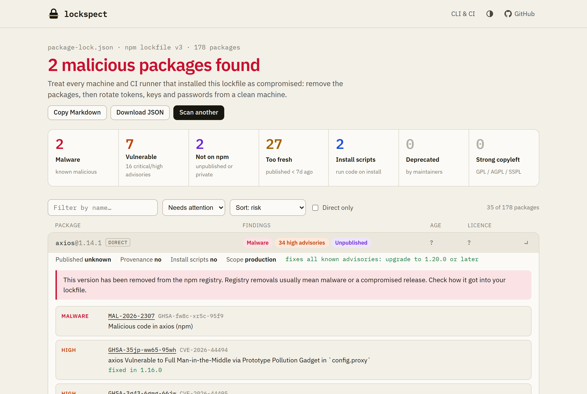

<div align="center">

# lockspect

**Is your lockfile hiding something?**

Drop a `package-lock.json`, `pnpm-lock.yaml`, `yarn.lock` or `bun.lock` and see, in seconds, which exact versions are **malware**, **vulnerable**, **too fresh to trust**, **pulled from npm**, run **install scripts**, or carry **copyleft licences**. It runs in your browser, in your terminal and in CI.

[](https://github.com/feresbr1/lockspect/actions/workflows/ci.yml)
[](https://github.com/feresbr1/lockspect/actions/workflows/pages.yml)
[](LICENSE)

### [Open lockspect →](https://feresbr1.github.io/lockspect/)

No install, no account, and your lockfile never leaves the tab.



</div>

---

## Why

In March 2026 a hijacked release of **axios**, `axios@1.14.1`, shipped a payload through a new dependency, `plain-crypto-js@4.2.1` (advisories [MAL-2026-2307](https://osv.dev/vulnerability/MAL-2026-2307) and [MAL-2026-2306](https://osv.dev/vulnerability/MAL-2026-2306)). Both versions have since been removed from npm, but any project that installed them in that window still has them written into its lockfile. The same pattern runs through TanStack, Shai-Hulud, `chalk`/`debug` and dozens of smaller incidents.

The questions people then ask are simple, but most tools answer only part of them:

- **Did we install a malicious version?** `npm audit` is npm-only, and `pnpm audit` started failing with HTTP 410 in April 2026 when npm retired its legacy audit endpoints ([pnpm#11265](https://github.com/pnpm/pnpm/issues/11265)).
- **Did we install anything brand new?** Hijacked releases are often caught and pulled within days. Release cooldowns (`min-release-age`, `minimumReleaseAge`, `npmMinimalAgeGate`) exist for this reason, but nothing tells you what in your current lockfile is inside that window.
- **Is anything in here no longer on npm?** An unpublished version in your lockfile is a red flag.

lockspect answers all of them from the file you already have, for every major package manager, without installing anything.

## What it checks

| Check                  | What it means                                                                                         | Source                                      |
| ---------------------- | ----------------------------------------------------------------------------------------------------- | ------------------------------------------- |
| 🟥 **Malware**         | Version is listed as malicious (`MAL-*` advisories from OpenSSF, GitHub, Amazon Inspector and others) | [OSV.dev](https://osv.dev)                  |
| 🟧 **Vulnerable**      | Published GHSA / CVE advisories, with severity and the lowest version that fixes them                 | OSV.dev                                     |
| 🟪 **Not on npm**      | Version is missing from the public registry: unpublished (often removed malware) or private           | deps.dev + npm registry                     |
| 🟨 **Too fresh**       | Published inside your cooldown window (1, 3, 7, 14 or 30 days)                                        | [deps.dev](https://deps.dev) + npm registry |
| 🟦 **Install scripts** | Package runs code during install (where the lockfile records it)                                      | lockfile                                    |
| ⬜ **Deprecated**      | Maintainer-deprecated versions, with the reason                                                       | deps.dev                                    |
| ⬜ **Strong copyleft** | GPL / AGPL / SSPL and similar, with a licence breakdown for everything else                           | deps.dev                                    |
| 🟩 **Provenance**      | Which versions have a verified npm provenance attestation                                             | deps.dev                                    |

It also generates the config to **refuse fresh releases at install time** for npm, pnpm, Yarn, Bun, Renovate and Dependabot, in the right unit for each (days, minutes or seconds).

## Quick start

### In the browser

Open **https://feresbr1.github.io/lockspect/**, then drop, choose or paste (`Ctrl/⌘ + V`) your lockfile. Click _a lockfile hit by the axios compromise_ to see a real detection.

### Command line

Requires Node.js 18.17 or newer. Nothing else is installed: the CLI is a single bundled file.

```sh
npx github:feresbr1/lockspect
```

Or download `lockspect.mjs` from the [latest release](https://github.com/feresbr1/lockspect/releases/latest) and run `node lockspect.mjs`.

```text
$ npx github:feresbr1/lockspect examples/axios-compromise/package-lock.json

package-lock.json · npm lockfile v3 · 178 packages
✖ 2 malicious packages found

  malware          2
  vulnerable       7  (3 critical, 13 high, 26 moderate, 3 low advisories)
  not on npm       2
  fresh (<7d)      27
  install scripts  2
  deprecated       0
  strong copyleft  0
  provenance       47/178

 ✖ axios@1.14.1 (direct)  MALWARE · 34 high · unpublished  → 1.20.0
      MAL-2026-2307  Malicious code in axios (npm)
      …
 ✖ plain-crypto-js@4.2.1  MALWARE · unpublished
      MAL-2026-2306  Malicious code in plain-crypto-js (npm)
   tinypool@1.1.1  2 critical  → 2.1.2
   …
2 packages matched --fail-on malware
```

(Counts for vulnerabilities and fresh releases change as new advisories and releases are published.)

<h3 id="command-line">Options</h3>

```text
lockspect [lockfile] [options]

  -c, --cooldown <days>     Flag versions younger than this (default 7)
  -f, --fail-on <rules>     Exit 1 when a package matches (default "malware")
                            malware, vuln (any), vuln:critical, vuln:high, vuln:moderate,
                            vuln:low, missing, fresh, install-script, deprecated, copyleft, none
      --json                Print the full report as JSON
      --markdown            Print a Markdown summary (for PR comments)
      --markdown-file <p>   Also append the Markdown summary to a file
  -a, --all                 List every package, not only flagged ones
      --allow-incomplete    Exit 0/1 even if a data source could not be reached
      --no-color            Disable colours (NO_COLOR is also respected)
```

Exit codes: `0` nothing matched, `1` something matched `--fail-on`, `2` usage error, unreadable lockfile or incomplete scan.

### Examples

```sh
# Block the build on malware or critical/high advisories
npx github:feresbr1/lockspect --fail-on malware,vuln:high

# Treat anything published in the last 3 days as a failure
npx github:feresbr1/lockspect pnpm-lock.yaml --cooldown 3 --fail-on malware,fresh

# Post a summary on a pull request
npx github:feresbr1/lockspect --markdown > lockspect.md

# Feed another tool
npx github:feresbr1/lockspect --json --fail-on none | jq '.packages[] | select(.flags | index("malware"))'
```

### GitHub Action

```yaml
# .github/workflows/lockspect.yml
name: lockspect
on: [pull_request, push]
jobs:
  scan:
    runs-on: ubuntu-latest
    steps:
      - uses: actions/checkout@v4
      - uses: feresbr1/lockspect@v1
        with:
          fail-on: malware,vuln:critical # default: malware
          cooldown: 7 # days
          # path: apps/web/pnpm-lock.yaml  # default: first lockfile found
```

The report is written to the job summary. This repository scans its own lockfile with the action on every push.

## Supported lockfiles

| Package manager | File                                       | Versions                    | Direct deps |  Dev flag   | Install scripts |
| --------------- | ------------------------------------------ | --------------------------- | :---------: | :---------: | :-------------: |
| npm             | `package-lock.json`, `npm-shrinkwrap.json` | lockfileVersion 1, 2, 3     |     v2+     |      ✓      |       v2+       |
| pnpm            | `pnpm-lock.yaml`                           | 5.x, 6.x, 9.x               |      ✓      |      ✓      |    5.x, 6.x     |
| Yarn classic    | `yarn.lock`                                | v1                          |             |             |                 |
| Yarn Berry      | `yarn.lock`                                | v2, v3, v4 (incl. `patch:`) |      ✓      |             |                 |
| Bun             | `bun.lock`                                 | text lockfile               |      ✓      | direct only |                 |

npm aliases (`npm:real@1.0.0`) resolve to the real package. Workspace, git, `file:` and tarball-URL dependencies are listed as _not checked_. Bun's binary `bun.lockb` is not supported; run `bun install --save-text-lockfile` to create `bun.lock`.

## Privacy

- The lockfile is parsed locally, in the browser tab or in the CLI process. It is never uploaded.
- Only **package names and versions** are sent to the public [OSV.dev](https://osv.dev) and [deps.dev](https://deps.dev) APIs (both maintained by Google), plus `registry.npmjs.org` for versions deps.dev has not indexed yet.
- The website has no backend, cookies, analytics or accounts. It is a static page on GitHub Pages. The only thing stored is your cooldown and theme preference, in `localStorage`.

## How it works

```
lockfile ──parse──▶ [name@version …] ──▶ OSV querybatch ──▶ advisories (MAL-*, GHSA, CVE)
                                     ├─▶ deps.dev versionbatch ──▶ publish date, licence, deprecation, provenance
                                     └─▶ npm registry (only for versions deps.dev doesn't know) ──▶ unpublished? publish date
```

Everything lives in [`src/core`](src/core): lockfile parsers, data sources and report building, with no Node or DOM dependencies. The web app ([`src/web`](src/web), Preact + Vite) and the CLI ([`src/cli`](src/cli), bundled with esbuild into one file) are thin layers on top.

## Limitations

- Results are only as complete as OSV.dev and deps.dev. A brand-new compromise may not have an advisory yet. That is what the _Too fresh_ check is for.
- Install-script data comes from the lockfile, so it is unavailable for Yarn, Bun and pnpm v9 lockfiles. pnpm 5/6 `requiresBuild` can also mark packages that only need a build step.
- Only the npm ecosystem is supported. PyPI, Cargo and Go lockfiles are not.
- Private packages from other registries show as _Not on npm_ when their lockfile entry points at the public registry.
- Very large lockfiles (thousands of packages) look up at most 150 versions on the npm registry when deps.dev has no record of them. The report says so when this happens.

## Development

```sh
git clone https://github.com/feresbr1/lockspect && cd lockspect
npm install
npm run dev          # web app at http://localhost:5173/lockspect/
npm test             # unit + integration tests (mocked network)
LIVE=1 npm test      # also hit the real OSV.dev / deps.dev / npm APIs
npm run test:e2e     # Playwright, desktop + mobile (npx playwright install chromium first)
npm run check        # format, lint, typecheck, tests, build
```

`npm run build` writes the site to `dist/web` and the CLI to `dist/cli/lockspect.mjs`. The CLI bundle is committed so that `npx github:` and the GitHub Action work without a build step, and CI fails if it is out of date.

See [CONTRIBUTING.md](CONTRIBUTING.md) for the details, and [docs/PRODUCT_DECISIONS.md](docs/PRODUCT_DECISIONS.md) for why lockspect works the way it does.

## Links

- Live app: https://feresbr1.github.io/lockspect/
- Releases: https://github.com/feresbr1/lockspect/releases
- Issues and ideas: https://github.com/feresbr1/lockspect/issues
- Security policy: [SECURITY.md](SECURITY.md)

## License

[MIT](LICENSE). Advisory data © the respective OSV.dev sources; package metadata from deps.dev and the npm registry.
